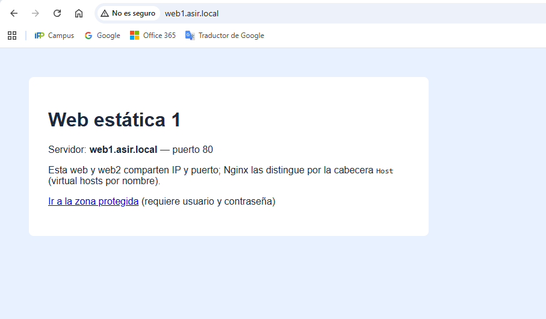
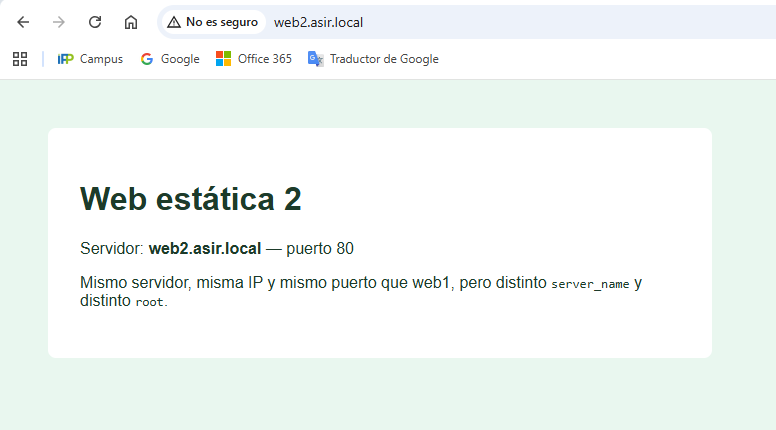

# 2. Dos webs estáticas con distinto dominio y el mismo puerto (80)

**Objetivo:** servir `web1.asir.local` y `web2.asir.local` desde el mismo servidor, la misma IP y el mismo puerto 80.

**Cómo funciona:** son *virtual hosts* basados en nombre. Los dos bloques `server` hacen `listen 80`, pero cada uno tiene un `server_name` distinto. Cuando llega una petición, NGINX mira la cabecera `Host:` que envía el navegador y elige el bloque cuyo `server_name` coincide.

## 2.1 Crear el contenido

```bash
sudo mkdir -p /var/www/web1 /var/www/web2
sudo nano /var/www/web1/index.html      # contenido en www/web1/index.html
sudo nano /var/www/web2/index.html      # contenido en www/web2/index.html
```

Permisos (propietario `www-data`, directorios 755, ficheros 644):

```bash
sudo chown -R www-data:www-data /var/www/web1 /var/www/web2
sudo find /var/www/web1 /var/www/web2 -type d -exec chmod 755 {} \;
sudo find /var/www/web1 /var/www/web2 -type f -exec chmod 644 {} \;
```

## 2.2 Server block de web1

`/etc/nginx/sites-available/web1.asir.local`

```nginx
server {
    listen 80;
    listen [::]:80;

    server_name web1.asir.local;
    root /var/www/web1;
    index index.html;

    access_log /var/log/nginx/web1_access.log;
    error_log  /var/log/nginx/web1_error.log;

    location / {
        try_files $uri $uri/ =404;
    }

    # (la zona protegida /privado/ se añade en el apartado 3)

    location ~ /\. {
        deny all;          # no servir ficheros ocultos
    }
}
```

## 2.3 Server block de web2

`/etc/nginx/sites-available/web2.asir.local`

```nginx
server {
    listen 80;
    listen [::]:80;

    server_name web2.asir.local;
    root /var/www/web2;
    index index.html;

    access_log /var/log/nginx/web2_access.log;
    error_log  /var/log/nginx/web2_error.log;

    location / {
        try_files $uri $uri/ =404;
    }
}
```

| Directiva | Significado |
|---|---|
| `listen 80` | Puerto en el que escucha (IPv4). `listen [::]:80` es lo mismo para IPv6. |
| `server_name` | Dominio al que responde este bloque. **Es lo que diferencia web1 de web2.** |
| `root` | Carpeta donde están los ficheros de la web. |
| `index` | Fichero que se sirve al pedir un directorio. |
| `try_files $uri $uri/ =404` | Busca el fichero, luego el directorio; si no existe devuelve 404. |
| `access_log` / `error_log` | Logs separados por sitio, muy útiles para depurar. |

## 2.4 Server por defecto (recomendado)

Si alguien accede por IP o con un dominio que no coincide con ningún `server_name`, NGINX usa el primer bloque cargado o el marcado como `default_server`. Para no mostrar web1 "por accidente", se sustituye el `default` por uno que corta la conexión:

`/etc/nginx/sites-available/default`

```nginx
server {
    listen 80 default_server;
    listen [::]:80 default_server;
    server_name _;
    return 444;      # código especial de nginx: cierra la conexión sin responder
}
```

## 2.5 Habilitar y recargar

```bash
sudo ln -s /etc/nginx/sites-available/web1.asir.local /etc/nginx/sites-enabled/
sudo ln -s /etc/nginx/sites-available/web2.asir.local /etc/nginx/sites-enabled/
sudo nginx -t
sudo systemctl reload nginx
```

## 2.6 Comprobación

```bash
curl -s http://web1.asir.local/ | grep "<h1>"
#     <h1>Web estática 1</h1>
curl -s http://web2.asir.local/ | grep "<h1>"
#     <h1>Web estática 2</h1>

# Prueba definitiva: misma IP, solo cambia la cabecera Host
curl -s -H "Host: web2.asir.local" http://127.0.0.1/ | grep "<h1>"
#     <h1>Web estática 2</h1>
```

| web1.asir.local | web2.asir.local |
|---|---|
|  |  |
