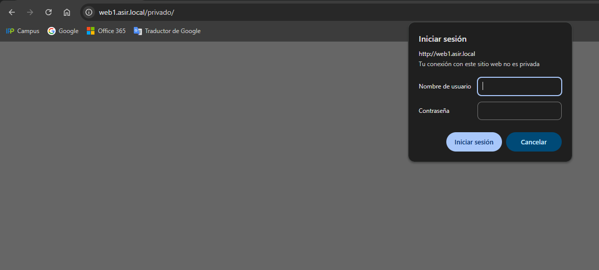
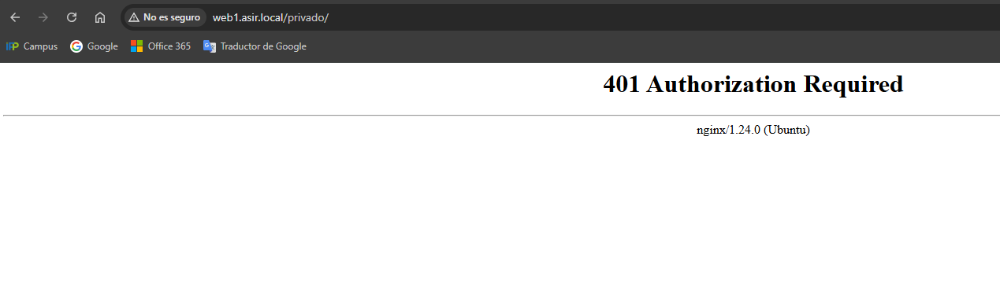
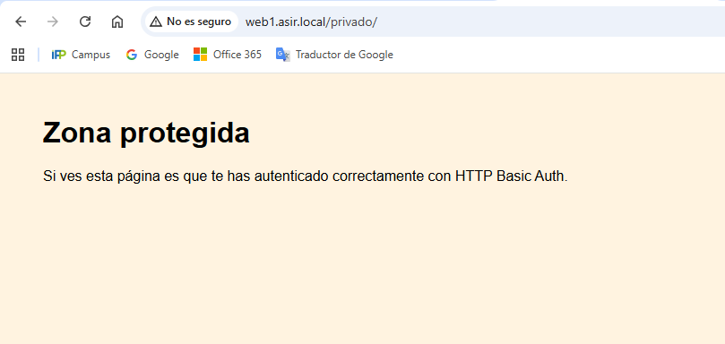

# 3. Acceder a una zona protegida

**Objetivo:** que `http://web1.asir.local/privado/` pida usuario y contraseña.

Se usa el módulo `ngx_http_auth_basic_module` (autenticación HTTP Basic). El servidor responde `401 Unauthorized` con la cabecera `WWW-Authenticate`; el navegador muestra la ventana de login y reenvía la petición con la cabecera `Authorization: Basic base64(usuario:contraseña)`.

## 3.1 Crear el contenido protegido

```bash
sudo mkdir -p /var/www/web1/privado
sudo nano /var/www/web1/privado/index.html     # contenido en www/web1/privado/index.html
sudo chown -R www-data:www-data /var/www/web1/privado
```

## 3.2 Crear el fichero de usuarios

```bash
sudo htpasswd -c /etc/nginx/.htpasswd alumno      # -c crea el fichero (solo la primera vez)
sudo htpasswd /etc/nginx/.htpasswd profesor       # añadir más usuarios SIN -c
sudo chown root:www-data /etc/nginx/.htpasswd
sudo chmod 640 /etc/nginx/.htpasswd
cat /etc/nginx/.htpasswd
# alumno:$apr1$NNyWnTPG$BBme5TM0D846cnaD65BaI0
```

La contraseña se guarda como *hash* (APR1-MD5), no en claro. El fichero está **fuera de `/var/www`**, así que no se puede descargar desde la web.

> ⚠️ **Cuidado:** usar `-c` con un fichero que ya existe lo sobrescribe y borra los usuarios anteriores.

## 3.3 Añadir la `location` protegida en web1

En `/etc/nginx/sites-available/web1.asir.local`, dentro del bloque `server`:

```nginx
    location /privado/ {
        auth_basic           "Zona restringida - ASIR";
        auth_basic_user_file /etc/nginx/.htpasswd;
        try_files $uri $uri/ =404;
    }
```

```bash
sudo nginx -t && sudo systemctl reload nginx
```

## 3.4 Comprobación

```bash
# Sin credenciales → 401
curl -sI http://web1.asir.local/privado/
# HTTP/1.1 401 Unauthorized
# WWW-Authenticate: Basic realm="Zona restringida - ASIR"

# Contraseña incorrecta → 401
curl -s -o /dev/null -w "%{http_code}\n" -u alumno:malapass http://web1.asir.local/privado/
# 401

# Credenciales correctas → 200
curl -s -u alumno:Asir2026 http://web1.asir.local/privado/ | grep "<h1>"
#   <h1>Zona protegida</h1>
```

El navegador pide las credenciales:



| Al cancelar: 401 Authorization Required | Tras autenticarse (200) |
|---|---|
|  |  |

## 3.5 Nota de seguridad

Basic Auth **solo codifica en Base64, no cifra**: cualquiera que capture el tráfico (Wireshark) puede ver usuario y contraseña. En producción debe ir **siempre sobre HTTPS** y conviene limitar los intentos con `limit_req` (o `fail2ban` leyendo el `error_log`) para frenar ataques de fuerza bruta. También se puede combinar con restricción por IP:

```nginx
    location /privado/ {
        satisfy all;                 # exige IP permitida Y contraseña
        allow 192.168.88.0/24;
        deny  all;
        auth_basic           "Zona restringida - ASIR";
        auth_basic_user_file /etc/nginx/.htpasswd;
    }
```
