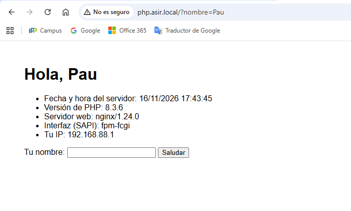
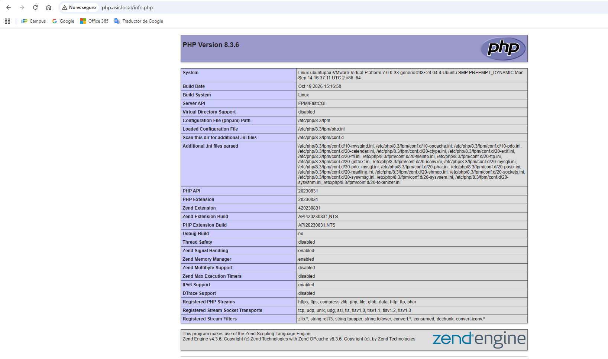

# 4. Web dinámica con PHP

**Objetivo:** `http://php.asir.local` genera la página en cada petición con PHP.

## 4.1 Cómo se ejecuta PHP con NGINX

NGINX **no tiene intérprete de PHP** (a diferencia de Apache con `mod_php`). Lo que hace es reenviar las peticiones `.php` por el protocolo **FastCGI** a un servicio aparte, **PHP-FPM** (*FastCGI Process Manager*), que ejecuta el script y le devuelve el HTML.

```
navegador ──HTTP──► nginx ──FastCGI (socket unix)──► php8.3-fpm ──► ejecuta index.php
         ◄──HTML───        ◄────────── resultado ─────────────
```

Ver dónde escucha PHP-FPM (el `fastcgi_pass` de NGINX tiene que coincidir **exactamente**):

```bash
grep -E '^listen' /etc/php/8.3/fpm/pool.d/www.conf
# listen = /run/php/php8.3-fpm.sock
# listen.owner = www-data
# listen.group = www-data
```

## 4.2 Contenido

```bash
sudo mkdir -p /var/www/php
sudo nano /var/www/php/index.php      # contenido en www/php/index.php
sudo nano /var/www/php/info.php       # <?php phpinfo();  (solo para probar, luego se borra)
sudo chown -R www-data:www-data /var/www/php
```

`index.php` muestra la fecha del servidor, la versión de PHP, la SAPI (`fpm-fcgi`) y saluda con el nombre recibido por GET. El parámetro se escapa con `htmlspecialchars()` para evitar **XSS**.

## 4.3 Server block

`/etc/nginx/sites-available/php.asir.local`

```nginx
server {
    listen 80;
    listen [::]:80;

    server_name php.asir.local;
    root /var/www/php;
    index index.php index.html;

    access_log /var/log/nginx/php_access.log;
    error_log  /var/log/nginx/php_error.log;

    location / {
        try_files $uri $uri/ =404;
    }

    location ~ \.php$ {
        include snippets/fastcgi-php.conf;
        fastcgi_pass unix:/run/php/php8.3-fpm.sock;
    }

    location ~ /\. {
        deny all;
    }
}
```

| Directiva | Significado |
|---|---|
| `index index.php` | Al pedir `/` sirve `index.php`. |
| `location ~ \.php$` | Expresión regular: todo lo que termine en `.php`. |
| `include snippets/fastcgi-php.conf` | Fichero de Ubuntu/Debian que define `SCRIPT_FILENAME`, `PATH_INFO` y hace `try_files $fastcgi_script_name =404` (si el .php no existe, 404 en vez de pasarlo a PHP). |
| `fastcgi_pass` | A dónde se envía la petición: el socket de PHP-FPM (o `127.0.0.1:9000` si FPM escucha por TCP). |

```bash
sudo ln -s /etc/nginx/sites-available/php.asir.local /etc/nginx/sites-enabled/
sudo nginx -t && sudo systemctl reload nginx
```

## 4.4 Comprobación

```bash
curl -s "http://php.asir.local/?nombre=ASIR" | grep -E "<h1>|<li>"
#   <h1>Hola, ASIR</h1>
#     <li>Fecha y hora del servidor: 16/11/2026 16:11:46</li>
#     <li>Versión de PHP: 8.3.6</li>
#     <li>Servidor web: nginx/1.24.0</li>
#     <li>Interfaz (SAPI): fpm-fcgi</li>

# El XSS se neutraliza
curl -s "http://php.asir.local/?nombre=%3Cscript%3Ealert(1)%3C/script%3E" | grep "<h1>"
#   <h1>Hola, &lt;script&gt;alert(1)&lt;/script&gt;</h1>

curl -s http://php.asir.local/info.php | grep -o "<title>.*</title>"
# <title>PHP 8.3.6 - phpinfo()</title>
```

Si recargas la página, la hora cambia: el contenido se genera en el servidor en cada petición (web **dinámica**). En la captura, accediendo desde Windows, la IP del cliente que ve PHP es `192.168.88.1` (el anfitrión en la red Solo anfitrión de VMware).

| index.php | phpinfo() |
|---|---|
|  |  |

**Al terminar:** `sudo rm /var/www/php/info.php` — `phpinfo()` expone rutas, versiones y configuración que un atacante puede aprovechar.
