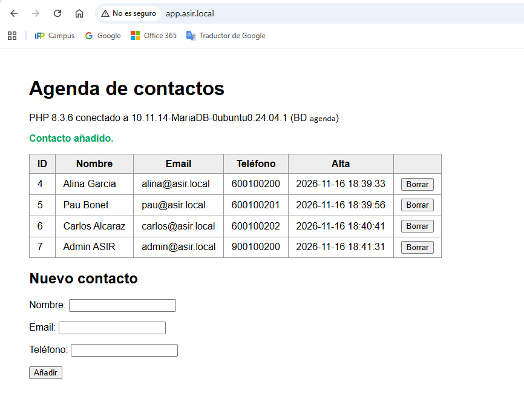

# 5. Web con PHP + MySQL (MariaDB)

**Objetivo:** `http://app.asir.local` es una agenda de contactos que lee, inserta y borra registros en una base de datos.

## 5.1 Base de datos

Fichero `sql/agenda.sql`:

```sql
SET NAMES utf8mb4;
CREATE DATABASE IF NOT EXISTS agenda CHARACTER SET utf8mb4 COLLATE utf8mb4_unicode_ci;

-- Usuario propio con permisos SOLO sobre esta BD y solo desde localhost
CREATE USER IF NOT EXISTS 'agenda_user'@'localhost' IDENTIFIED BY 'Asir2026!';
GRANT SELECT, INSERT, UPDATE, DELETE ON agenda.* TO 'agenda_user'@'localhost';
FLUSH PRIVILEGES;

USE agenda;
CREATE TABLE IF NOT EXISTS contactos (
  id        INT AUTO_INCREMENT PRIMARY KEY,
  nombre    VARCHAR(100) NOT NULL,
  email     VARCHAR(150) NOT NULL,
  telefono  VARCHAR(20),
  creado    TIMESTAMP DEFAULT CURRENT_TIMESTAMP
);
INSERT INTO contactos (nombre, email, telefono) VALUES
  ('Ana García',  'ana@asir.local',   '600111222'),
  ('Luis Pérez',  'luis@asir.local',  '600333444'),
  ('Marta López', 'marta@asir.local', '600555666');
```

Importarlo y comprobarlo:

```bash
sudo mariadb < agenda.sql
sudo mariadb -e "SELECT * FROM agenda.contactos; SHOW GRANTS FOR 'agenda_user'@'localhost';"
```

**Principio de mínimo privilegio:** la web **no** usa `root`. Usa `agenda_user`, que solo puede hacer `SELECT/INSERT/UPDATE/DELETE` sobre `agenda` (no puede crear ni borrar tablas, ni tocar otras BD) y solo desde `localhost`. Si alguien compromete la web, el daño queda limitado a esa BD.

## 5.2 Código PHP

```bash
sudo mkdir -p /var/www/app
sudo nano /var/www/app/config.php     # contenido en www/app/config.php
sudo nano /var/www/app/index.php      # contenido en www/app/index.php
sudo chown -R www-data:www-data /var/www/app
sudo chmod 640 /var/www/app/config.php     # contiene la contraseña de la BD
```

`config.php` (conexión con **PDO**):

```php
define('DB_HOST', 'localhost');
define('DB_NAME', 'agenda');
define('DB_USER', 'agenda_user');
define('DB_PASS', 'Asir2026!');

function conectar(): PDO {
    $dsn = 'mysql:host=' . DB_HOST . ';dbname=' . DB_NAME . ';charset=utf8mb4';
    return new PDO($dsn, DB_USER, DB_PASS, [
        PDO::ATTR_ERRMODE            => PDO::ERRMODE_EXCEPTION,
        PDO::ATTR_DEFAULT_FETCH_MODE => PDO::FETCH_ASSOC,
        PDO::ATTR_EMULATE_PREPARES   => false,
    ]);
}
```

Partes importantes de `index.php`:

```php
// Inserción con consulta preparada → evita inyección SQL
$st = $db->prepare('INSERT INTO contactos (nombre, email, telefono) VALUES (?, ?, ?)');
$st->execute([$nombre, $email, $tel]);

// Lectura
$contactos = $db->query('SELECT id, nombre, email, telefono, creado FROM contactos ORDER BY id')->fetchAll();

// Si falla la conexión: el detalle va al log y al usuario solo un mensaje genérico
} catch (PDOException $e) {
    http_response_code(500);
    error_log('Error BD: ' . $e->getMessage());
    die('<h1>Error de conexión con la base de datos</h1>');
}
```

Medidas de seguridad aplicadas en el código:

- **Consultas preparadas** (`prepare` + `execute`): los datos del usuario nunca se concatenan en el SQL → sin **inyección SQL**.
- **`htmlspecialchars()`** al mostrar datos → sin **XSS** almacenado.
- **`filter_var(..., FILTER_VALIDATE_EMAIL)`** para validar el email.
- Errores de BD **al log**, no a pantalla (no se filtran usuario, host ni estructura).

## 5.3 Server block

`/etc/nginx/sites-available/app.asir.local`

```nginx
server {
    listen 80;
    listen [::]:80;

    server_name app.asir.local;
    root /var/www/app;
    index index.php;

    access_log /var/log/nginx/app_access.log;
    error_log  /var/log/nginx/app_error.log;

    location / {
        try_files $uri $uri/ =404;
    }

    # El fichero con la contraseña de la BD nunca se sirve ni se ejecuta desde fuera
    location = /config.php {
        deny all;
    }

    location ~ \.php$ {
        include snippets/fastcgi-php.conf;
        fastcgi_pass unix:/run/php/php8.3-fpm.sock;
    }

    location ~ /\. {
        deny all;
    }
}
```

```bash
sudo ln -s /etc/nginx/sites-available/app.asir.local /etc/nginx/sites-enabled/
sudo nginx -t && sudo systemctl reload nginx
```

## 5.4 Comprobación

```bash
# Lectura: la web muestra los datos de la BD
curl -s http://app.asir.local/ | grep conectado
#   <p>PHP 8.3.6 conectado a 10.11.14-MariaDB-0ubuntu0.24.04.1 (BD <code>agenda</code>)</p>

# Inserción desde la web
curl -s -X POST -d "accion=alta&nombre=Pruebas Curl&email=curl@asir.local&telefono=600999000" \
     http://app.asir.local/ | grep -E 'class="msg"|Pruebas'
#   <p class="msg">Contacto añadido.</p>
#       <td>Pruebas Curl</td>

# El registro está en la BD
sudo mariadb -e "SELECT id,nombre,email FROM agenda.contactos"

# Intento de inyección SQL: se guarda como texto normal, no se ejecuta
curl -s -X POST --data-urlencode "accion=alta" --data-urlencode "nombre=x' OR '1'='1" \
     --data-urlencode "email=sqli@asir.local" http://app.asir.local/ | grep "x&#039;"
#       <td>x&#039; OR &#039;1&#039;=&#039;1</td>

# Las credenciales no son accesibles
curl -s -o /dev/null -w "%{http_code}\n" http://app.asir.local/config.php
# 403
```


