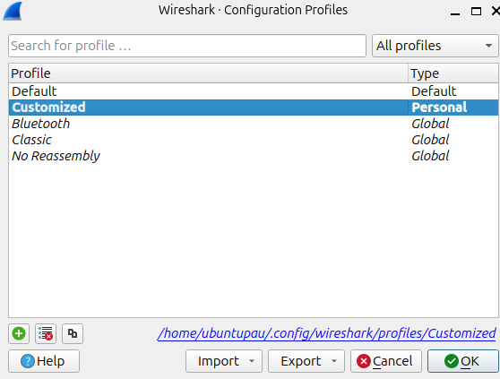

# Wireshark – Amenazas y ataques (tutoriales de Palo Alto Networks · Unit 42)

**Módulo 0378 – Seguridad y Alta Disponibilidad · Actividad M0378T1A1 · CFGS ASIR**

Alumno: Pau Bonet

Guía paso a paso de los 6 tutoriales de Wireshark de Unit 42 (Palo Alto Networks). Para cada tutorial se indica qué hacer, en qué orden y qué se debería ver. Los resultados de los tutoriales 1–5 están comprobados con tshark 4.2.2 sobre los mismos pcaps.

## Entorno

| Elemento | Valor |
|---|---|
| Sistema | Ubuntu Desktop (máquina virtual en VMware Workstation, 4 GB de RAM, 2 CPU) |
| Red | Adaptador 1 NAT + Adaptador 2 Solo anfitrión, **desconectados** durante el análisis |
| Herramienta | Wireshark (paquete `wireshark` de Ubuntu), perfil propio `Customized` |
| Material | pcaps de Unit 42 y de malware-traffic-analysis.net (ZIP con contraseña `infected`) |
| Capturas de pantalla | Desde el anfitrión Windows (Win+Shift+S) |

No se captura tráfico en directo: todos los tutoriales trabajan sobre ficheros `.pcap` ya grabados, que se abren con **File > Open**.

---

## 0. Preparación

### 0.1 Entorno

VM con Ubuntu Desktop en VMware (4 GB de RAM y 2 CPU sobran). Los pcaps contienen malware real para Windows (Loki Bot, IcedID, Trickbot, Dridex…), que en Ubuntu no se puede ejecutar. Aun así, nunca se abren los `.exe`/`.dll` que se exportan.

### 0.2 Instalar Wireshark

Con el adaptador NAT conectado, en una terminal (Ctrl+Alt+T):

```bash
sudo apt update && sudo apt install -y wireshark git unzip
```

Si pregunta si los usuarios sin privilegios pueden capturar paquetes, da igual la respuesta: no se va a capturar en directo. Wireshark se abre desde el menú de aplicaciones, nunca con `sudo`.

### 0.3 Descargar los pcaps

```bash
mkdir ~/wireshark-lab && cd ~/wireshark-lab
git clone https://github.com/PaloAltoNetworks/Unit42-Wireshark-tutorials            # tutoriales 1–4
git clone https://github.com/pan-unit42/wireshark-tutorial-decrypting-HTTPS-traffic  # tutorial 5
```

Tutorial 6 (Trickbot): en Firefox, entrar en malware-traffic-analysis.net, página del 25/09/2019, y guardar los dos ZIP en `~/wireshark-lab`.

### 0.4 Extraer

Todos los ZIP tienen la contraseña `infected`. Se extraen a una carpeta `pcaps`:

```bash
find ~/wireshark-lab -name "*.zip" -exec unzip -o -P infected {} -d ~/wireshark-lab/pcaps \;
```

Si algún ZIP da error de contraseña o de método:

```bash
sudo apt install -y p7zip-full
7z x -pinfected fichero.zip -o$HOME/wireshark-lab/pcaps
```

### 0.5 Desconectar la red de la VM

En VMware, **VM > Settings > Network Adapter (NAT)**: desmarcar *Connected* y *Connect at power on*. Lo mismo con **Network Adapter 2 (Host-only)**. En **Options > Shared Folders**, dejarlo en *Disabled*.

### 0.6 Abrir los pcaps

En Wireshark: **File > Open** > `~/wireshark-lab/pcaps`. No hace falta elegir ninguna interfaz de red.

### 0.7 Capturas de pantalla

Desde Windows con Win+Shift+S sobre la ventana de VMware. Se guardan en `img/` con nombres tipo `T1-01-perfil.png` o `T2-03-basic-dns.png`.

---

## 1. Personalizar las columnas

**Objetivo:** dejar un perfil de Wireshark con las columnas Time (UTC) · Src · Src port · Dst · Dst port · Host · Info. Todos los demás tutoriales parten de este perfil.

**Pcap:** `Wireshark-tutorial-column-setup.pcap`

### Pasos

1. **Perfil propio:** Edit > Configuration Profiles > seleccionar *Default* > Copy > renombrarlo `Customized` > OK. Comprobar en la esquina inferior derecha que está activo.

   

2. **Hora en UTC:** View > Time Display Format > *UTC Date and Time of Day*. Luego View > Time Display Format > *Seconds*.
3. **Quitar columnas:** clic derecho en el título de la columna **No.** > *Remove this Column*. Lo mismo con **Protocol** y **Length**. Desmarcar la casilla de una columna en ese menú solo la oculta; para borrarla hay que usar *Remove this Column* (o Edit > Preferences > Appearance > Columns > botón **−**).
4. **Columnas de puertos:** clic derecho en un título de columna > *Column Preferences* > botón **+**.
   - Columna `Src port`, tipo *Src port (unresolved)*; otra `Dst port`, tipo *Dest port (unresolved)*.
   - Arrastrar cada una detrás de Source y Destination. Cambiar Source a *Src addr (unresolved)* y Destination a *Dest addr (unresolved)*.
   - Clic derecho en los títulos de los puertos > *Align Left*.
5. **Columna Host (HTTP):** desmarcar View > Packet Bytes. Filtrar `http.request` y seleccionar el primer paquete con **un solo clic** (con doble clic se abre en una ventana aparte, cuyo menú no tiene *Apply as Column*). En el panel de detalle desplegar *Hypertext Transfer Protocol*, clic derecho en la línea *Host* > *Apply as Column* (o Ctrl+Shift+I).
6. **Columna Server Name (HTTPS):** filtrar `tls.handshake.type eq 1` (Client Hello). Desplegar Transport Layer Security > Handshake Protocol: Client Hello > Extension: server_name > Server Name Indication. Clic derecho en *Server Name* > *Apply as Column*.
7. **Fusionar Host + SNI:** en Column Preferences, editar el campo de la columna Host y poner:

   ```
   http.host or tls.handshake.extensions_server_name
   ```

   Borrar la columna Server Name con **−**.
8. **Filtro combinado:**

   ```
   http.request or tls.handshake.type eq 1
   ```

   > **Captura pendiente (T1-02):** vista final con las columnas nuevas.

9. **Exportar el perfil:** Edit > Configuration Profiles > Export > guardar `customized-profiles.zip`. Sirve para llevarlo al ordenador de clase.

### Qué se debería ver

74 paquetes con ese filtro, todos desde 172.16.1.135. El primero es `www.msftconnecttest.com` por el puerto 80 (07/08/2023 18:57:00 UTC). Después vienen dominios de Microsoft por el 443, como `geo.prod.do.dsp.mp.microsoft.com`, `v20.events.data.microsoft.com` y `www.bing.com`. El nombre del dominio aparece en la columna Host sin abrir cada paquete.

---

## 2. Filtros de visualización

**Objetivo:** crear 3 botones de filtro reutilizables y usarlos en 5 pcaps con 5 tipos de malware.

**ZIP:** `Wireshark-tutorial-filter-expressions-5-pcaps.zip` · con el perfil *Customized* activo.

### 2.1 Crear los botones

Se escribe la expresión en la barra de filtro (verde = válida, roja = error, amarilla = aviso), se pulsa el **+** a la derecha de la barra, se pone la etiqueta y se guarda.

| Botón | Expresión | Para qué sirve |
|---|---|---|
| basic | `(http.request or tls.handshake.type eq 1) and !(ssdp)` | Peticiones HTTP y dominios HTTPS, sin ruido SSDP |
| basic+ | `(http.request or tls.handshake.type eq 1 or (tcp.flags.syn eq 1 and tcp.flags.ack eq 0)) and !(ssdp)` | Añade los SYN: tráfico no web y conexiones fallidas |
| basic+dns | `(http.request or tls.handshake.type eq 1 or (tcp.flags.syn eq 1 and tcp.flags.ack eq 0) or dns) and !(ssdp)` | Añade DNS: relaciona dominios con IPs |

Operadores: `and`/`&&`, `or`/`||`, `!`/`not`, `eq`/`==`, `contains`.

> **Captura pendiente (T2-01):** los 3 botones en la barra.

### 2.2 Recorrido por los 5 pcaps

| Pcap | Filtro | Qué se debe encontrar | Malware |
|---|---|---|---|
| 1 de 5 | `http.request` | 49 POST desde 10.8.15.101 a `194.55.224[.]9/luiz/five/fre.php`. Clic derecho > Follow > HTTP Stream para ver el C2 | Loki Bot |
| 2 de 5 | basic | HTTP a `vrondafarih[.]com` (139.59.26.99) y HTTPS a `magiketchinn[.]com` (104 veces) y `magizanqomo[.]com`, ambos en 2.56.177.122 | IcedID (Bokbot) |
| 3 de 5 | basic+dns | DNS de `adaisreal.ddns[.]net` que resuelve a 87.121.221.212 y SYN a ese host al puerto TCP 7888 (paquetes 1478–1480) | Ave Maria / Warzone RAT |
| 4 de 5 | `ftp.request.command or (ftp-data and tcp.seq eq 1)` | FTP a 190.107.177.239 (`valvulasthermovalve[.]cl`). USER y PASS en claro y un STOR que sube `PW_user1-DESKTOP-USER1PC_…html` con credenciales robadas | Infostealer por FTP |
| 5 de 5 | `smtp or dns`, luego `smtp.req.command` y `smtp.data.fragment` | Muchos DNS de servidores de correo, la mayoría con STARTTLS. `smtp.data.fragment` da 7 correos sin cifrar | Spambot (spam tipo Emotet con adjunto OneNote) |

En el pcap 4 se guarda también el filtro de FTP como botón.

> **Capturas pendientes (T2-02 a T2-06):** una por pcap.

---

## 3. Identificar hosts y usuarios

**Objetivo:** ante un equipo comprometido, sacar su IP, MAC, nombre de host, usuario y sistema operativo solo a partir del tráfico.

**ZIP:** `Wireshark-tutorial-identifying-hosts-and-users-5-pcaps.zip`

### Pasos

1. **DHCP (pcap 1):** filtrar `dhcp`. Abrir el *DHCP Request* y mirar Ethernet II (MAC origen), *Option 50 Requested IP Address* y *Option 12 Host Name*.
2. **NBNS (pcaps 1 y 2):** filtrar `nbns`. El nombre NetBIOS aparece en la columna Info.
3. **Kerberos (pcap 3):** filtrar `kerberos.CNameString`. En un paquete AS-REQ desplegar hasta *CNameString*, clic derecho > *Apply as Column*. Los nombres que acaban en `$` son cuentas de equipo; los demás, cuentas de usuario.
4. **LDAP (pcap 3):** filtrar `ldap contains "CN=Users"` para ver el nombre completo del usuario.
5. **Nombre por defecto de Windows (pcap 3):** filtrar `ip contains "DESKTOP-"` (distingue mayúsculas). Otra opción: Edit > Find Packet > *Packet details* + *String* > `desktop-`.
6. **User-Agent (pcaps 3, 4 y 5):** filtrar basic o `http.request`. Clic derecho > Follow > TCP Stream y leer la línea `User-Agent`.

### Qué se debería obtener

| Pcap | IP | MAC | Host | Usuario | Dispositivo / SO |
|---|---|---|---|---|---|
| 1 | 172.16.1.38 | f8:ff:c2:04:a5:7b | jeremiahs-MBP (DHCP) / JEREMIAHS-MBP (NBNS) | — | MacBook Pro (MAC de Apple) |
| 2 | 172.16.1.101 | 78:c2:3b:b8:93:e8 | DESKTOP-HVKYP4S (grupo WORKGROUP) | — | Windows |
| 3 | 172.16.1.141 | 00:51:8a:93:d2:f6 | DESKTOP-HSJD5R8 | rene.mccollum (Kerberos) = Rene McCollum (LDAP) | Windows 10/11, Edge 110.0.1587.69. Dominio pcapworkshop.net, DC 172.16.1.16 |
| 4 | 172.16.1.62 | ee:eb:5a:4b:32:bb | — | — | Google Pixel 4a (5G), Android 13, Chrome 113 |
| 5 | 172.16.1.35 | 36:de:af:61:93:31 | — | — | iPhone con iOS 16.4.1, Safari |

> **Capturas pendientes (T3-01 a T3-05):** una por pcap mostrando el dato clave.

La MAC y el User-Agent se pueden falsificar o anonimizar. Una identificación fiable cruza varias fuentes (DHCP + NBNS + Kerberos).

---

## 4. Exportar objetos de un pcap

**Objetivo:** sacar del tráfico los ficheros transferidos (malware, páginas, correos) y verificarlos por tipo y hash, no por su extensión.

**ZIP:** `Wireshark-tutorial-extracting-objects-5-pcaps.zip` · **en la VM de Ubuntu y sin abrir los ficheros.**

El menú es siempre **File > Export Objects >** HTTP / SMB / IMF / FTP-DATA. Después, en la terminal, se verifica cada fichero:

```bash
file <fichero>
sha256sum <fichero>
```

### Pcaps

| Pcap | Protocolo y método | Qué sale | Verificación |
|---|---|---|---|
| 1 de 5 | Filtro `http.request`, Export Objects > HTTP | `Invoice&MSO-Request.doc` y `knr.exe` de `smart-fax[.]com` (107.180.50.162) | .doc = Composite Document File V2, SHA256 `f808229a…a054fb`. .exe = PE32 executable, SHA256 `749e1616…2db18` |
| 2 de 5 | Export Objects > HTTP, primera fila | Página de phishing de PayPal en `www.paypalaccountsloginn.myddns[.]com`; luego un POST a `/auth/verifychallenge` con las credenciales | Abrirla solo en un entorno aislado: puede llamar a dominios maliciosos |
| 3 de 5 | Export Objects > SMB | Dos .exe copiados por SMB a `\\10.6.26[.]6\C$\WINDOWS\` (712 kB y 115 kB): Trickbot moviéndose al controlador de dominio | Columna Content Type a `[100.0%]` = fichero completo. SHA256 `59896ae5…010040` y `cf99990b…f82560` |
| 4 de 5 | Filtro `smtp.data.fragment` (50 asuntos), Export Objects > IMF | 50 correos .eml de spam de sextorsión | Se abren con un editor de texto o Thunderbird |
| 5 de 5 | Filtro `ftp.request.command or (ftp-data and tcp.seq eq 1)`, Export Objects > FTP-DATA | USER/PASS en claro, RETR de q.exe, w.exe, e.exe, r.exe y t.exe, y 5 STOR que suben logs HTML con credenciales robadas | FTP-DATA exporta los HTML pero no los .exe (ver abajo) |

### Exportar los .exe del pcap 5 a mano

1. Filtrar `ftp-data.command contains ".exe" and tcp.seq eq 1`.
2. Follow > TCP Stream.
3. *Show data as* > **Raw**.
4. *Save as…* `q.exe`.

El flujo empieza por `MZ` y "This program cannot be run in DOS mode": es la firma de un ejecutable de Windows. SHA256 de q.exe: `ca34b092…d2a3bd`.

> **Capturas pendientes (T4-01 a T4-05):** ventana de Export Objects de cada pcap + terminal con `file`/`sha256sum`. Opcional: un hash buscado en VirusTotal.

---

## 5. Descifrar tráfico HTTPS

**Objetivo:** comprobar que con el fichero de claves de sesión TLS (key log, el que genera la variable `SSLKEYLOGFILE` en navegadores) el HTTPS se lee como HTTP.

**Ficheros:** `Wireshark-tutorial-on-decrypting-HTTPS-SSL-TLS-traffic.pcap` y `Wireshark-tutorial-KeysLogFile.txt`. Contiene una infección de **Dridex**.

### Pasos

1. **Antes de descifrar:** abrir el pcap y aplicar el botón **basic**. Solo se ven IPs, puertos y nombres SNI; `http.request` da 0 resultados. Los dominios son `config.edge.skype.com`, `settings-win-ppe.data.microsoft.com`, `self.events.data.microsoft.com`, `foodsgoodforliver[.]com` (94.103.84.245) y `105711[.]com` (162.255.119.253).

   > **Captura pendiente (T5-01):** antes de descifrar.

2. **Abrir el key log** en un editor: son líneas `CLIENT_RANDOM <random> <master secret>`.

   > **Captura pendiente (T5-02):** el fichero de claves.

3. **Cargar las claves:** Edit > Preferences > Protocols > **TLS**. En *(Pre)-Master-Secret log filename* pulsar Browse, elegir `Wireshark-tutorial-KeysLogFile.txt` y OK.

   > **Captura pendiente (T5-03):** la ventana de preferencias.

4. **Después de descifrar:** volver a aplicar basic. Aparecen las peticiones HTTP bajo las líneas HTTPS:
   - `GET foodsgoodforliver[.]com/invest_20.dll`: descarga de la DLL de Dridex.
   - `POST 105711[.]com/docs.php` (3 veces): tráfico de mando y control (C2).
   - Tráfico legítimo a Microsoft y Skype.

   > **Captura pendiente (T5-04):** después de descifrar.

5. **Seguir el flujo:** clic derecho en el GET > Follow > HTTP Stream. La respuesta empieza por `MZ`.
6. **Exportar la DLL:** File > Export Objects > HTTP > `invest_20.dll`. `file` debe decir *PE32 executable (DLL)*. SHA256:

   ```
   31cf42b2a7c5c558f44cfc67684cc344c17d4946d3a1e0b2cecb8eb58173cb2f
   ```

TLS protege en tránsito, pero quien tenga las claves de sesión lo lee todo. Por eso la inspección TLS corporativa es posible, y por eso hay que proteger los ficheros de claves.

---

## 6. Examinar infecciones de Trickbot

**Objetivo:** reconocer el patrón de tráfico de Trickbot, un troyano bancario y ladrón de credenciales activo desde 2016. Se distribuye por malspam o lo instalan otros malware como Emotet.

**Pcaps** (malware-traffic-analysis.net, 25/09/2019, contraseña `infected`):

- `2019-09-25-Trickbot-gtag-ono19-infection-traffic.pcap.zip` (Trickbot por malspam)
- `2019-09-25-Emotet-infection-with-Trickbot-in-AD-environment.pcap.zip` (Emotet + Trickbot en Active Directory)

Los resultados de esta parte son los del artículo de Unit 42; no están comprobados con tshark.

### A) Trickbot por malspam

Aplicar **basic** y después **basic+**. La cadena de infección:

1. El enlace del correo descarga un ZIP con `InvoiceAndStatement.lnk` desde `www.dchristjan[.]com`.
2. El .lnk descarga el ejecutable inicial de Trickbot desde `144.91.69[.]195`.
3. Comprobaciones de IP pública contra servicios legítimos (`ipecho[.]net`, `icanhazip[.]com`, `checkip.amazonaws[.]com`, `ipinfo[.]io`…). No son maliciosas por sí solas, pero en este contexto son un indicador.
4. C2 por HTTPS en puertos no estándar: varios intentos al 443 y conexión con éxito a `187.58.56[.]26:449`. Los puertos 447/449 son típicos de Trickbot.
5. Robo de datos: filtrar `http.request and tcp.port eq 8082`. POST a `170.238.117[.]187` con la ruta `/ono19/BACHMANN-BTO-PC_W617601.<id>/`. El sufijo `81/` lleva contraseñas, `83/` datos de formularios y `90/` información del sistema. `ono19` es el *gtag* (identificador de campaña). Usar Follow > TCP Stream.

   > **Captura pendiente (T6-01).**

6. Más ejecutables disfrazados: filtrar `http.request and ip contains .png`. Son 3 GET a ficheros .png cuya cabecera dice `image/png` pero que en realidad son EXE/DLL. Exportarlos con Export Objects > HTTP y comprobarlo con `file`.

   > **Captura pendiente (T6-02).**

### Certificados

Filtrar `tls.handshake.type == 11` y abrir el certificado del tráfico al puerto 449. Trae los valores por defecto de OpenSSL: countryName=AU, stateOrProvinceName=*Some-State*, organizationName=*Internet Widgits Pty Ltd*. Compararlo con uno legítimo de Microsoft (US, Washington, Redmond, Microsoft Corporation).

> **Captura pendiente (T6-03):** los dos certificados.

### B) Trickbot instalado por Emotet en un AD

El cliente infectado es 10.9.25.102 y el controlador de dominio 10.9.25.9. Emotet usa HTTP con datos codificados; Trickbot usa HTTPS. Se busca el tráfico SMB repetido por el TCP 445 del cliente al DC (seguir el flujo desde el puerto 49321, un exploit tipo EternalBlue). Después el propio DC descarga Trickbot desde `185.98.87[.]185/wredneg2.png`. Es movimiento lateral.

> **Captura pendiente (T6-04).**

---

## Fuentes

- [Unit 42 – Changing Your Column Display](https://unit42.paloaltonetworks.com/unit42-customizing-wireshark-changing-column-display/)
- [Unit 42 – Display Filter Expressions](https://unit42.paloaltonetworks.com/using-wireshark-display-filter-expressions/)
- [Unit 42 – Identifying Hosts and Users](https://unit42.paloaltonetworks.com/using-wireshark-identifying-hosts-and-users/)
- [Unit 42 – Exporting Objects from a Pcap](https://unit42.paloaltonetworks.com/using-wireshark-exporting-objects-from-a-pcap/)
- [Unit 42 – Decrypting HTTPS Traffic](https://unit42.paloaltonetworks.com/wireshark-tutorial-decrypting-https-traffic/)
- [Unit 42 – Examining Trickbot Infections](https://unit42.paloaltonetworks.com/wireshark-tutorial-examining-trickbot-infections/)
- [Repositorio de pcaps (GitHub)](https://github.com/PaloAltoNetworks/Unit42-Wireshark-tutorials)
- [Repositorio HTTPS (GitHub)](https://github.com/pan-unit42/wireshark-tutorial-decrypting-HTTPS-traffic)
- [Pcaps de Trickbot – malware-traffic-analysis.net](https://www.malware-traffic-analysis.net/2019/09/25/index.html)
