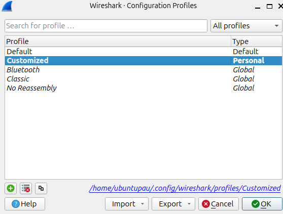

# 1. Personalizar las columnas

**Objetivo:** dejar un perfil de Wireshark con las columnas Time (UTC) · Src · Src port · Dst · Dst port · Host · Info. Todos los demás tutoriales parten de este perfil.

**Pcap:** `Wireshark-tutorial-column-setup.pcap`

## Pasos

1. **Perfil propio:** Edit > Configuration Profiles > seleccionar *Default* > Copy > renombrarlo `Customized` > OK. Comprobar en la esquina inferior derecha que está activo.

   

2. **Hora en UTC:** View > Time Display Format > *UTC Date and Time of Day*. Luego View > Time Display Format > *Seconds*.
3. **Quitar columnas:** clic derecho en el título de la columna **No.** > *Remove this Column*. Lo mismo con **Protocol** y **Length**. Desmarcar la casilla de una columna en ese menú solo la oculta; para borrarla hay que usar *Remove this Column* (o Edit > Preferences > Appearance > Columns > botón **−**).
4. **Columnas de puertos:** clic derecho en un título de columna > *Column Preferences* > botón **+**.
   - Columna `Src port`, tipo *Src port (unresolved)*; otra `Dst port`, tipo *Dest port (unresolved)*.
   - Arrastrar cada una detrás de Source y Destination. Cambiar Source a *Src addr (unresolved)* y Destination a *Dest addr (unresolved)*.
   - Clic derecho en los títulos de los puertos > *Align Left*.
5. **Columna Host (HTTP):** desmarcar View > Packet Bytes. Filtrar `http.request` y seleccionar el primer paquete con **un solo clic** (con doble clic se abre en una ventana aparte, cuyo menú no tiene *Apply as Column*). En el panel de detalle desplegar *Hypertext Transfer Protocol*, clic derecho en la línea *Host* > *Apply as Column* (o Ctrl+Shift+I).
6. **Columna Server Name (HTTPS):** filtrar `tls.handshake.type eq 1` (Client Hello). Desplegar Transport Layer Security > Handshake Protocol: Client Hello > Extension: server_name > Server Name Indication. Clic derecho en *Server Name* > *Apply as Column*.
7. **Fusionar Host + SNI:** en Column Preferences, editar el campo de la columna Host y poner:

   ```
   http.host or tls.handshake.extensions_server_name
   ```

   Borrar la columna Server Name con **−**.
8. **Filtro combinado:**

   ```
   http.request or tls.handshake.type eq 1
   ```

   > **Captura pendiente (T1-02):** vista final con las columnas nuevas.

9. **Exportar el perfil:** Edit > Configuration Profiles > Export > guardar `customized-profiles.zip`. Sirve para llevarlo al ordenador de clase.

## Qué se debería ver

74 paquetes con ese filtro, todos desde 172.16.1.135. El primero es `www.msftconnecttest.com` por el puerto 80 (07/08/2023 18:57:00 UTC). Después vienen dominios de Microsoft por el 443, como `geo.prod.do.dsp.mp.microsoft.com`, `v20.events.data.microsoft.com` y `www.bing.com`. El nombre del dominio aparece en la columna Host sin abrir cada paquete.
